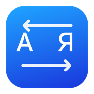
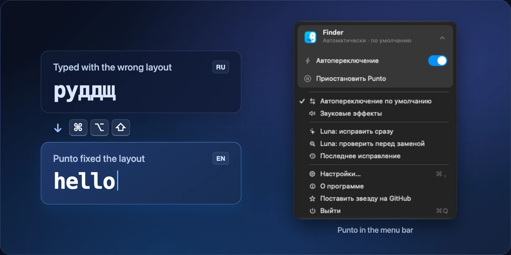
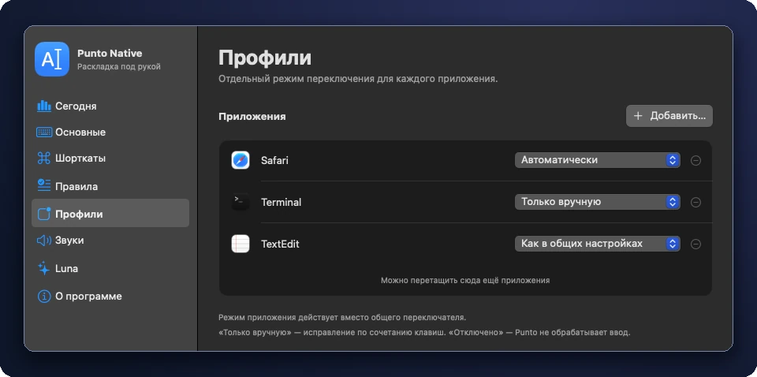
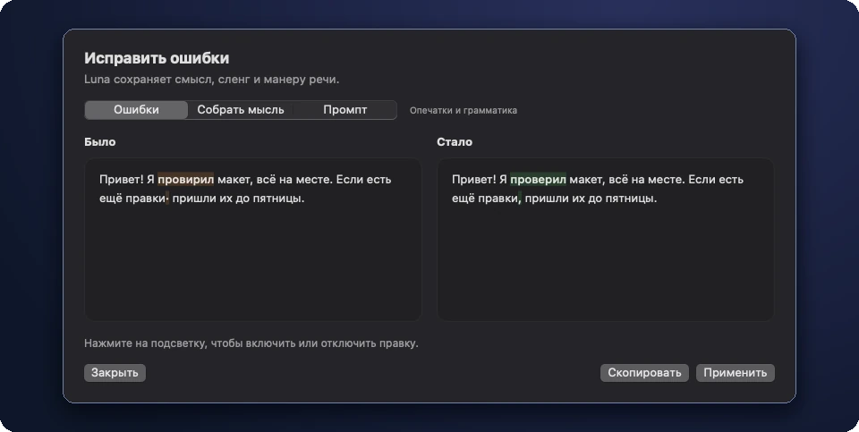

<p align="center">
  
</p>

<h1 align="center">Punto Native</h1>

<p align="center">A Russian–English keyboard layout switcher for macOS.</p>

<p align="center">
  <a href="https://github.com/rshagiev/punto-switcher/releases/latest"><strong>Download for Mac</strong></a> ·
  <a href="#install">Install</a> ·
  <a href="CHANGELOG.md">Release notes</a> ·
  <a href="README.md">Русский</a>
</p>

<p align="center">macOS 14+ · Apple Silicon (M1 or newer)</p>



Punto Native is a Punto Switcher alternative for Mac. Type `руддщ` and press **⌘⌥⇧** (Command + Option + Shift) to get `hello`. The shortcut fixes the last word or a selected phrase. You can turn on automatic correction and customize the shortcuts. Punto lives in the menu bar and corrects layouts on your Mac. The app interface is in Russian.

## Install

1. [Download the DMG](https://github.com/rshagiev/punto-switcher/releases/latest) and drag **PuntoNative.app** into Applications.
2. Quit any other keyboard layout switcher.
3. Open Punto and click **«Настроить Punto»** (Set up Punto). Drag its card into the list that opens in System Settings and enable access. Punto opens any additional permission page it needs.

The build is currently distributed without Apple notarization. If macOS blocks it, allow it to open in System Settings → Privacy & Security.

To check for updates in 2.0.11 and later, click the circular arrow next to the status in Settings. In 2.0.5–2.0.10, open About → Updates. To upgrade from 2.0.4 or earlier, replace the app using the latest DMG.

## A mode for each app

Use automatic correction in Safari and switch to manual correction in Terminal. Drag an app from Finder into **«Профили»** (Profiles), or change the mode for your current app directly in the Punto menu. Settings also include custom text rules, per-app layout memory, and learning from undone corrections.



## Edit text with Luna

Select text or place the cursor in a paragraph. Luna can **fix it immediately** or **show a comparison before replacing it**. In the review window, you can fix errors, clean up dictation, or turn a rough brief into a prompt. Click a highlight to accept or reject an individual edit, then copy or apply the result.



To use Luna, install [Codex CLI](https://github.com/openai/codex#quickstart), sign in, then click **«Попробовать на примере»** (Try an example) in Luna settings. Choose GPT-6 Luna or GPT-5.6 Luna. Requests use your Codex account limits. Keyboard layout correction works offline with Punto alone.

## Privacy

Punto keeps no typing history. Settings, counters, and learning words stay on your Mac. Luna sends only the selected text or current paragraph to Codex when invoked. Your Codex account settings and policies apply to those requests.

<details>
<summary>Usage analytics</summary>

Punto offers usage analytics during setup. The checkbox is selected initially, and collection begins after you confirm it. You can change your choice in General → Privacy. PostHog Cloud EU retains events for one year. Events include a random installation ID, Punto and macOS versions, first launch, keyboard readiness, active days, update outcomes, support invitation impressions, and GitHub clicks. Analytics excludes typed text, clipboard contents, app names, and document contents.

</details>

## Build from source

Requires Swift 6 and Xcode Command Line Tools.

```sh
swift run -c release PuntoChecks
bash Scripts/build-app.sh
open 'Build/Punto Native.app'
```

The default build uses ad-hoc signing. Set `CODE_SIGN_IDENTITY` to use your own certificate. Build a DMG with `bash Scripts/package-release.sh`.

[Architecture](docs/ARCHITECTURE.md) · [Verification](docs/VERIFICATION.md) · [Development history](docs/HISTORY.md) · [Report an issue](https://github.com/rshagiev/punto-switcher/issues)
