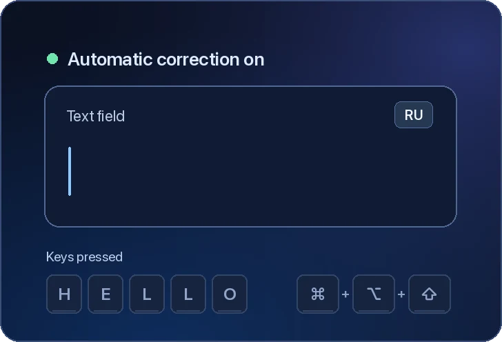

<p align="center">
  
</p>

<h1 align="center">Punto Native</h1>

<p align="center">A free keyboard layout switcher for Mac and an alternative to Punto Switcher. Fix Russian and English text typed in the wrong layout.</p>

<p align="center">
  <a href="https://github.com/rshagiev/punto-switcher/releases/latest"><strong>Download for Mac</strong></a> ·
  <a href="#install">Install</a> ·
  <a href="CHANGELOG.md">Release notes</a> ·
  <a href="README.md">Русский</a>
</p>

<p align="center">macOS 14+ · Apple Silicon (M1 or newer) · <a href="LICENSE">MIT-licensed source</a></p>


Punto lives in the menu bar. With **automatic correction** on, it detects and fixes wrong-layout words as you type. For **manual correction**, press **⌘⌥⇧** (Command + Option + Shift). For example, `руддщ` becomes `hello`. The shortcut works on the last word or selected text, even with automatic correction off. Use it right after an automatic correction in the same field to restore the original text and layout. The app interface is in Russian.

<p align="center">
  
</p>

## Install

1. [Download the DMG](https://github.com/rshagiev/punto-switcher/releases/latest) and drag **PuntoNative.app** into Applications.
2. Quit any other keyboard layout switcher.
3. Open Punto and click **«Настроить Punto»** (Set up Punto). Drag its card into the list that opens in System Settings and enable access. Punto opens any additional permission page it needs.

The build is currently distributed without Apple notarization. If macOS blocks it, allow it to open in System Settings → Privacy & Security.

To check for updates in 2.0.11 and later, click the circular arrow next to the status in Settings. In versions 2.0.5 through 2.0.10, open About → Updates. To upgrade from 2.0.4 or earlier, replace the app using the latest DMG.

## Automatic correction by app

Use automatic correction in Safari, keep Terminal on manual only, or turn Punto off entirely for another app. Drag an app from Finder into **«Профили»** (Profiles), or change the mode for the current app directly in the Punto menu.


## Edit text with Luna

Select text or place the cursor in a paragraph. Luna can **fix it immediately** or **show a comparison before replacing it**. In the review window, you can fix errors, clean up dictation, or turn a rough brief into a prompt. Click a highlight to accept or reject an individual edit, then copy or apply the result.


To use Luna, install [Codex CLI](https://github.com/openai/codex#quickstart), sign in, then click **«Попробовать на примере»** (Try an example) in Luna settings. Choose GPT-6 Luna or GPT-5.6 Luna. Requests use your Codex account limits.

## FAQ

**Does Punto run on Intel Macs?** Current builds require Apple Silicon (M1 or newer) and macOS 14 or later.

**Which keyboard layouts does Punto correct?** It converts text between English QWERTY and the standard Russian or Russian PC keyboard layout.

**Does keyboard layout correction work offline?** Both automatic and manual layout correction run on your Mac. The Codex connection is for Luna text editing.

**Can I fix wrong-layout text in Terminal?** Development checks included Terminal and Ghostty, as well as Safari and Codex. Punto skips secure fields. [See the verification notes](docs/VERIFICATION.md#проверки-в-приложениях).

## Privacy

Punto keeps no typing history. Settings, counters, and learning words stay on your Mac. Luna sends only the selected text or current paragraph to Codex when invoked. Your Codex account settings and policies apply to those requests.

<details>
<summary>Usage analytics</summary>

Punto offers usage analytics during setup. The checkbox is selected initially, and collection begins after you confirm it. You can change your choice in General → Privacy. PostHog Cloud EU retains events for one year. Events include a random installation ID, Punto and macOS versions, first launch, keyboard readiness, active days, update outcomes, support invitation impressions, and GitHub clicks. Analytics excludes typed text, clipboard contents, app names, and document contents.

</details>

## Build from source

Source code and documentation are available under the [MIT license](LICENSE). The license excludes the bundled language tables and sounds. Building requires Swift 6 and Xcode Command Line Tools.

```sh
swift run -c release PuntoChecks
bash Scripts/build-app.sh
open 'Build/Punto Native.app'
```

The default build uses ad-hoc signing. Set `CODE_SIGN_IDENTITY` to use your own certificate. Build a DMG with `bash Scripts/package-release.sh`.

[Architecture](docs/ARCHITECTURE.md) · [Verification](docs/VERIFICATION.md) · [Development history](docs/HISTORY.md) · [Report an issue](https://github.com/rshagiev/punto-switcher/issues)
