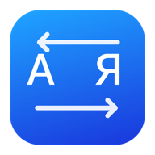
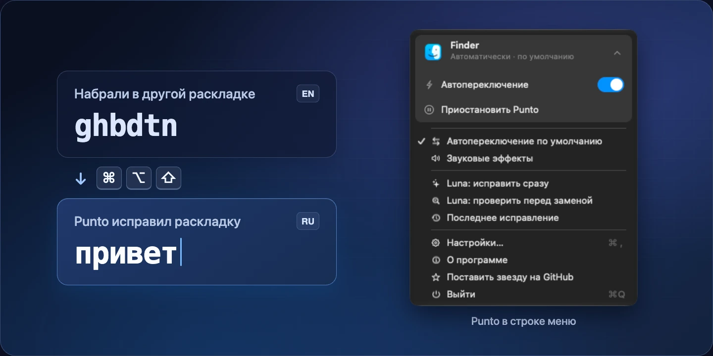
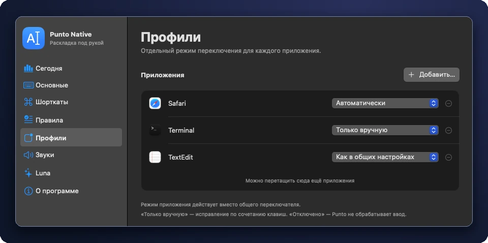
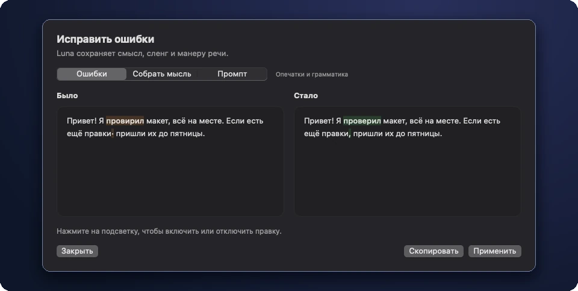

<p align="center">
  
</p>

<h1 align="center">Punto Native</h1>

<p align="center">Переключатель русской и английской раскладок для macOS.</p>

<p align="center">
  <a href="https://github.com/rshagiev/punto-switcher/releases/latest"><strong>Скачать для Mac</strong></a> ·
  <a href="#установка">Установка</a> ·
  <a href="CHANGELOG.md">Что нового</a> ·
  <a href="README.en.md">English</a>
</p>

<p align="center">macOS 14+ · Apple Silicon (M1 и новее)</p>



Punto Native — альтернатива Punto Switcher для Mac. Набрали `ghbdtn`? Нажмите **⌘⌥⇧** (Command + Option + Shift), и получится «привет». Сочетание работает с последним словом или выделенной фразой. Можно включить автоисправление и настроить свои сочетания. Punto живёт в строке меню и исправляет раскладку локально.

## Установка

1. [Скачайте DMG](https://github.com/rshagiev/punto-switcher/releases/latest) и перетащите **PuntoNative.app** в «Программы».
2. Завершите другой переключатель раскладки, если он запущен.
3. Откройте Punto и нажмите **«Настроить Punto»**. Перетащите карточку в открытый список в Системных настройках и включите доступ. Если потребуется ещё одно разрешение, Punto откроет нужный раздел.

Сборка пока без нотарификации Apple. Если macOS блокирует запуск, разрешите открытие в «Системные настройки» → «Конфиденциальность и безопасность».

Для проверки обновлений в 2.0.11 и новее нажмите круглую стрелку рядом со статусом в настройках. В 2.0.5–2.0.10 откройте «О программе» → «Обновления». Для перехода с 2.0.4 и более ранних версий замените приложение из нового DMG.

## Режим для каждого приложения

В Safari можно включить автоисправление, а в Terminal оставить только ручное. Перетащите приложение из Finder в раздел **«Профили»** или поменяйте режим текущего приложения прямо в меню Punto. В настройках также есть правила для слов и фрагментов, запоминание раскладки по приложениям и обучение на отменённых исправлениях.



## Редактирование текста с Luna

Выделите текст или поставьте курсор в абзац. Luna может **исправить сразу** или **открыть сравнение перед заменой**. В окне «Было / Стало» можно поправить ошибки, привести в порядок диктовку или собрать из черновика промпт. Нажмите на подсветку, чтобы принять или отклонить отдельную правку, затем скопируйте или примените результат.



Для Luna установите [Codex CLI](https://github.com/openai/codex#quickstart), войдите в свой аккаунт и нажмите **«Попробовать на примере»** в настройках Luna. Можно выбрать GPT-6 Luna или GPT-5.6 Luna. Запросы расходуют лимиты вашего аккаунта Codex. Для исправления раскладки достаточно самого Punto.

## Конфиденциальность

Punto не ведёт историю набора. Настройки, счётчики и слова для обучения хранятся на Mac. Luna отправляет выделенный текст или текущий абзац в Codex только по вашей команде. К запросам применяются настройки и правила вашего аккаунта Codex.

<details>
<summary>Данные об использовании</summary>

Punto предлагает делиться аналитикой при настройке. Галочка изначально отмечена, отправка начинается после подтверждения. Выбор можно изменить в «Основные» → «Конфиденциальность». PostHog Cloud EU хранит события год. Punto передаёт случайный ID установки, версии Punto и macOS, первый запуск, готовность клавиатуры, активные дни, исходы обновлений, показы приглашения поддержать проект и переходы на GitHub. Аналитика исключает набранный текст, буфер обмена, названия приложений и содержимое документов.

</details>

## Сборка из исходников

Нужны Swift 6 и Xcode Command Line Tools.

```sh
swift run -c release PuntoChecks
bash Scripts/build-app.sh
open 'Build/Punto Native.app'
```

По умолчанию сборка использует ad-hoc подпись. Для своего сертификата задайте `CODE_SIGN_IDENTITY`. DMG собирается командой `bash Scripts/package-release.sh`.

[Архитектура](docs/ARCHITECTURE.md) · [Проверки](docs/VERIFICATION.md) · [История разработки](docs/HISTORY.md) · [Сообщить о проблеме](https://github.com/rshagiev/punto-switcher/issues)
